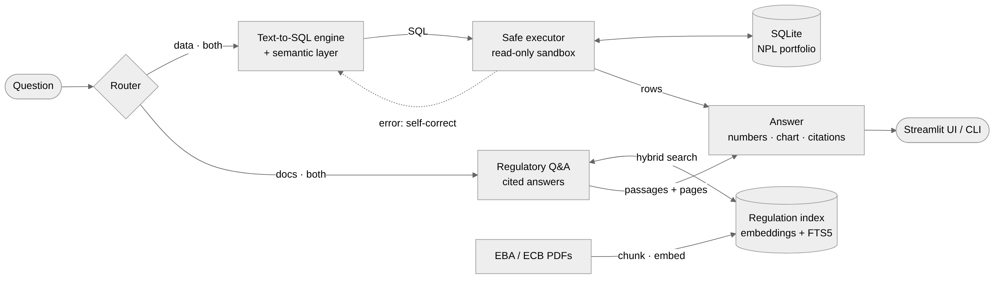
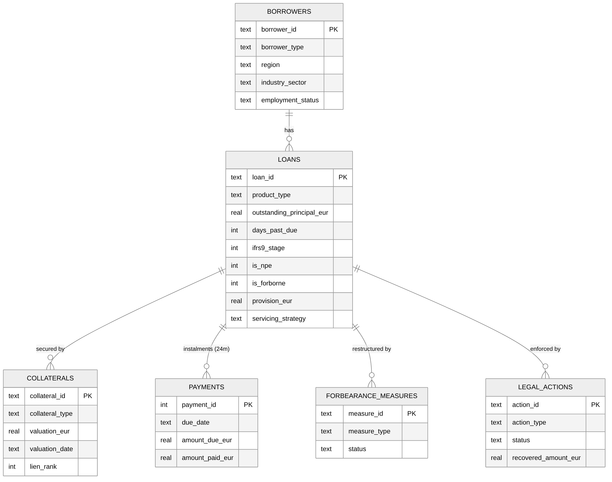

# 🏦 Loan Portfolio AI Copilot

**Ask questions about a non-performing loan (NPL) portfolio, and about the EBA / ECB rules that govern it, in plain English. Get the numbers, a chart and answers cited to the exact page of the regulation.**

The copilot is built for the analysts and portfolio managers of a loan servicer. It combines two AI capabilities:

- **Text-to-SQL** over the loan portfolio. It understands credit-risk language (NPE ratio, IFRS 9 stages, DPD buckets, forbearance, LTV, coverage) and turns questions into read-only SQL that runs in a sandbox that cannot modify or leak data.
- **RAG over regulation**. It answers questions from the official EBA and ECB guidance on non-performing and forborne exposures, citing the document and page for every statement, and it says so when the documents don't cover a question.

A **router** decides for each question whether it needs the data, the regulation, or both. For example: *"How many of our loans are forborne, and how long must the probation period last?"* Both capabilities are benchmarked against hand-written evaluation sets.

> ⚠️ All data is **synthetic**. It is generated by this repository and contains no real customers or institutions.

<p align="center">
  
</p>

<details>
<summary><b>More screenshots: auto-chart and result table</b></summary>
<br>


</details>

---

## Why this project

Most text-to-SQL demos stop at "LLM writes a query". Production teams in regulated finance need more than that:

| Problem in real loan servicing | How the copilot handles it |
|---|---|
| Business terms are not column names ("NPE ratio", "coverage", "restructured twice") | A **semantic layer** (`copilot/semantic_layer.yaml`) defines tables, a credit-risk glossary, SQL conventions and worked examples |
| An LLM must never be able to change data | **Engine-enforced read-only sandbox**. It uses a SQLite authorizer, not regex filtering (see [Safety](#-safety-by-design)) |
| LLM queries sometimes fail | **Self-correction loop**: database errors are fed back to the model, up to N retries |
| "Is it actually correct?" | **Execution-accuracy benchmark**: 28 analyst questions with hand-written gold SQL (`eval/questions.yaml`) |
| Data you can't trust gives answers you can't trust | **Data-quality suite**: 26 checks for referential integrity and EBA / IFRS 9 consistency rules |
| Analysts constantly look up rules in 100+ page guidelines | **RAG over EBA / ECB guidance** with page-level citations and refusal when the text doesn't cover the question |
| Regulatory text mixes concepts with exact terms ("unlikely to pay" vs "Article 178", "90 days") | **Hybrid retrieval**: semantic embeddings + keyword search (SQLite FTS5 / BM25), fused with Reciprocal Rank Fusion |
| Real questions mix numbers and rules | **Router** sends each question to the data, the regulation or both, and synthesises a combined answer |

## Features

- 💬 **Conversational analytics**: follow-ups keep context ("now split that by region")
- 📚 **Regulatory Q&A**: answers from 3 official documents (~290 pages) with `[n]` citations to document + page, and the source passages one click away
- 🧭 **Smart routing**: data, documents, or both, with a combined "numbers + rules + implication" answer
- 📊 **Auto-charts**: the LLM suggests a chart, which is validated against the actual result, with a heuristic fallback
- 📝 **Grounded summaries**: a second LLM call explains the result using only numbers from the returned rows
- 🔍 **Full transparency**: every answer shows the SQL, any rejected attempts, latency and token usage
- 🔐 **Privacy by design**: the LLM writes SQL but never touches the database. Queries run locally, and with summaries off no portfolio data leaves your machine ([details](#-data-privacy-what-leaves-your-machine))
- 📥 **CSV export** of every result
- 🧪 **61 unit tests** that run offline (no API key): sandbox attacks, engine behaviour with a scripted LLM, data rules, chunking, hybrid retrieval, citations, routing and the evaluation comparers
- ⌨️ **CLI mode** for terminal use

## Architecture

<p align="center"></p>

## 📚 Regulatory RAG

| Document | Pages | What it covers |
|---|---|---|
| **EBA/GL/2018/06**: Guidelines on management of non-performing and forborne exposures | 130 | NPE strategy (5% threshold), governance, forbearance, NPE recognition, write-offs, collateral valuation |
| **EBA/GL/2016/07**: Guidelines on the application of the definition of default | 29 | 90-days-past-due criterion, unlikeliness to pay, distressed restructuring, return to non-defaulted status |
| **ECB Guidance to banks on non-performing loans** (2017) | 131 | Supervisory expectations on NPL strategy, forbearance, recognition, provisioning, collateral |

**Pipeline** (`copilot/rag/`):

1. **Ingest**: PDF text extraction, removal of running headers/footers and page numbers, then **page-aware chunking** (about 1,200 characters with overlap, never crossing a page boundary, so every chunk has an exact page to cite). The result is 769 chunks.
2. **Index**: OpenAI `text-embedding-3-small` vectors plus a **SQLite FTS5** full-text index, both in a single file (`data/docs.db`). There is no vector-database server to run.
3. **Retrieve**: **hybrid search**. Cosine similarity and BM25 each return their top 30 chunks, and the two lists are merged with **Reciprocal Rank Fusion**. Embeddings catch meaning ("when does a loan stop being forborne"), and keywords catch exact terms ("Article 178", "300,000").
4. **Answer**: the LLM answers **only from the numbered passages**, cites `[n]` for every statement, and returns `answerable: false` instead of guessing.

## Data model

A synthetic book of **20,000 loans / 16,000 borrowers** (as of 30 Sep 2026), loosely modelled on the public EBA NPL data templates. About half the active GBV is non-performing, which is typical of a servicer's portfolio.

<p align="center"></p>

The generator enforces the rules a real risk-data team would test for:

- **NPE** ⇔ DPD > 90 **or** unlikely-to-pay. **Stage 3** ⇔ NPE. **Stage 2** for DPD > 30, forborne or SICR.
- **Forborne** ⇔ a measure is active or ended less than 24 months ago (probation period).
- Missed instalments in `payments` line up with DPD. Provisions scale with stage, LTV and time in default.
- It also includes realistic data issues to monitor, such as **stale collateral valuations** older than 3 years.

## Quickstart

Requires **Python 3.10+** and an **OpenAI API key**.

```bash
# 1. install
python3 -m venv .venv && source .venv/bin/activate
pip install -r requirements.txt

# 2. configure
cp .env.example .env          # then put your OPENAI_API_KEY in .env
python scripts/check_openai.py   # verifies key + model

# 3. build the data (≈10 s) and check it
python -m copilot.data.generate
python -m copilot.data.quality

# 4. regulation: download the public EBA/ECB PDFs and build the search index (≈1 min, < $0.01)
python scripts/download_docs.py
python -m copilot.rag.ingest

# 5. run
streamlit run app.py
```

Other commands:

```bash
python -m copilot.cli "What is the NPE ratio by region?"   # one-off question
python -m copilot.cli                                     # interactive terminal mode
python -m copilot.cli "When can a defaulted loan return to performing?"  # regulation question
python -m copilot.eval.run_eval                           # text-to-SQL benchmark
python -m copilot.eval.run_rag_eval                       # routing + RAG benchmark
python -m pytest -q                                       # unit tests (offline)
```


## Example questions

- *What is the NPE ratio by product type?*
- *Show GBV, provisions and coverage ratio by IFRS 9 stage.*
- *How many loans became non-performing in each quarter of 2025?*
- *Which forbearance measure types have the highest re-default rate?*
- *What is the average LTV of non-performing mortgages by region?*
- *How many collaterals have valuations older than 3 years?*
- *How much have we recovered from completed auctions?*

Regulation:

- *When does a forborne exposure stop being classified as forborne?*
- *When can a defaulted exposure return to non-defaulted status?*
- *Can indexed valuations be used instead of individual valuations for NPL collateral?*

Data + regulation:

- *How many of our active loans are forborne, and how long must the probation period last according to the guidelines?*
- *What is our NPE ratio, and what do the EBA guidelines require from banks above the NPE strategy threshold?*

## 🔒 Safety by design

LLM-generated SQL is treated as **untrusted input**. Protection works in layers, and the database engine itself enforces it:

1. The database is opened in **read-only mode** (`mode=ro`).
2. A **SQLite authorizer** runs during query compilation. It allows only `SELECT`, reads of allow-listed tables and views, and safe functions. `INSERT`/`UPDATE`/`DELETE`, DDL, `PRAGMA`, `ATTACH`, `sqlite_master`, `load_extension` and unknown tables are all **denied by the engine**. This includes cases hidden inside CTEs, such as `WITH x AS (...) DELETE ...`.
3. **One statement per call.** Payloads like `SELECT 1; DROP TABLE loans` are rejected.
4. A **wall-clock timeout** stops runaway queries such as infinite recursive CTEs, and a **row cap** limits result size.

All of this is covered by tests in `tests/test_safe_executor.py`.

## 🔐 Data privacy: what leaves your machine

**The LLM never connects to the database.** It only writes SQL as text. Queries run locally, inside the read-only sandbox, and the database file never leaves your machine.

| Sent to the LLM provider (OpenAI) | Never sent |
|---|---|
| Your question and the last few questions + SQL of the conversation (for follow-ups) | The database file or any table as a whole |
| The semantic layer: table/column descriptions, glossary, rules, example queries | Database credentials or connection details |
| Database error messages during self-correction (e.g. `no such column: x`), no row data | Rows beyond the summary preview |
| **Only if "Plain-English summary" is on:** up to the first 30 rows of the query result, to write the summary | |
| For regulation questions: the retrieved passages of the **public** EBA/ECB documents | |

Turn the **Plain-English summary** toggle off (sidebar) and **no portfolio data is sent at all**: only the question, the schema description and the generated SQL. Results are still shown as a table and chart, computed locally. The combined "data + regulation" synthesis is also skipped in that mode, because it would need to see the numbers.

For production use with real client data, the same design works with an enterprise LLM endpoint (e.g. Azure OpenAI in the client's own tenant) or a self-hosted model, by swapping the client in `copilot/llm.py`.

## 📏 Evaluation

`eval/questions.yaml` contains 28 analyst questions across 11 categories (portfolio, NPE, delinquency, IFRS 9, forbearance, collateral, legal, trends, borrowers, write-offs and strategy). Each one has hand-written gold SQL.

A prediction counts as **correct when its result set matches the gold result set** (execution accuracy). Column names, column order and row order are ignored, and so are rounding and the ratio-vs-percent scale. Extra columns are allowed.

```bash
python -m copilot.eval.run_eval
```

The run writes a markdown report to `eval/results/`, with accuracy per category, failures with their SQL, latency and tokens.

| Model | Execution accuracy | Median latency | Avg tokens / question |
|---|---|---|---|
| `gpt-5.4-mini` (first run) | 96.4% (27/28) | 1.6 s | ~3.2k |
| `gpt-5.4-mini` (after one semantic-layer fix) | **100% (28/28)** | 1.5 s | ~3.2k |

The single first-run failure was a classic credit-risk ambiguity: *"How many loans became non-performing in each quarter?"* was answered with the current NPE **stock** (`is_npe = 1`) instead of NPE **inflows** (all loans whose `default_date` falls in the period, including those later written off). One glossary rule in the semantic layer fixed it, with no code change.

> Note: the benchmark was also used during development, so treat 100% as an upper bound. New, unseen questions are the real test, and adding them to `eval/questions.yaml` is encouraged.

### Routing and regulatory Q&A

`eval/rag_questions.yaml` has 18 questions: 12 regulatory questions whose answers were located by hand in the PDFs (document + page + key fact), 1 question the documents cannot answer (it must be refused), and 5 routing checks (data / both).

| Metric | What it checks |
|---|---|
| Router accuracy | The question went to data, docs or both as expected |
| Retrieval hit@6 | A retrieved passage is on the page where the answer actually is (±1 page) |
| Answer accuracy | The answer states the key fact (e.g. "90 days", "two years") **and** cites a source, or correctly refuses |

```bash
python -m copilot.eval.run_rag_eval
```

| Model | Router accuracy | Retrieval hit@6 | Answer accuracy | Median latency (docs) |
|---|---|---|---|---|
| `gpt-5.4-mini` + `text-embedding-3-small` | **100% (18/18)** | **100% (12/12)** | **100% (13/13)** | 1.6 s |

Every answer quotes the exact thresholds from the source, e.g. *"at least 3 months"*, and *"at least 1 year"* for distressed restructuring. The out-of-scope question (*"What is the current ECB deposit facility rate?"*) is correctly declined. Full answers with their citations are in `eval/results/`.

> As with the SQL benchmark, these questions were written alongside the system, so read the results as a strong baseline rather than a guarantee. Adding new questions to `eval/rag_questions.yaml` is the best way to test it.

## Project structure

```
├── app.py                       # Streamlit UI
├── copilot/
│   ├── config.py                # settings, paths, allow-listed tables
│   ├── semantic_layer.yaml      # schema docs, credit-risk glossary, SQL rules, examples
│   ├── assistant.py             # router + orchestration (data / docs / both + synthesis)
│   ├── llm.py                   # LLM + embedding clients (OpenAI)
│   ├── charts.py                # chart validation & heuristics
│   ├── cli.py                   # terminal interface
│   ├── data/
│   │   ├── schema.sql           # DDL with constraints, indexes, overview view
│   │   ├── generate.py          # synthetic NPL portfolio generator
│   │   └── quality.py           # data-quality checks
│   ├── sql/
│   │   ├── engine.py            # question → SQL → execute → self-correct → summarise
│   │   ├── safe_executor.py     # read-only sandbox
│   │   └── semantic.py          # renders the semantic layer for the prompt
│   ├── rag/
│   │   ├── sources.py           # registry of EBA / ECB documents
│   │   ├── ingest.py            # PDF → clean pages → chunks → embeddings + FTS5
│   │   ├── retriever.py         # hybrid search (vectors + BM25, RRF fusion)
│   │   └── answerer.py          # grounded answers with [n] citations
│   └── eval/
│       ├── compare.py           # execution-accuracy result comparison
│       ├── run_eval.py          # text-to-SQL benchmark
│       └── run_rag_eval.py      # routing + retrieval + answer benchmark
├── eval/questions.yaml          # 28 questions with gold SQL
├── eval/rag_questions.yaml      # 18 routing / regulation questions with source pages
├── scripts/
│   ├── check_openai.py          # key / model check
│   └── download_docs.py         # fetches the public EBA / ECB PDFs
└── tests/                       # 61 offline tests
```

## Roadmap

- [x] **Phase 1**: synthetic portfolio, data-quality suite, text-to-SQL with safe execution, self-correction, evaluation, UI
- [x] **Phase 2**: **RAG over regulation**: answers from public EBA/ECB guidance with page-level citations, hybrid retrieval, evaluation
- [x] **Phase 3**: **Router**: one question can trigger SQL, document search or both, with a combined answer
- [ ] PostgreSQL + pgvector backend, Docker Compose, CI

## Tech stack

Python · OpenAI API (chat + embeddings) · SQLite (+ FTS5) · pypdf · pandas / NumPy · Streamlit · Plotly · pytest

---

Built by **Adam Diamantidis**, Data Engineer (data pipelines, SQL, Azure, Power BI) and MSc Applied Data Science, Utrecht University.
