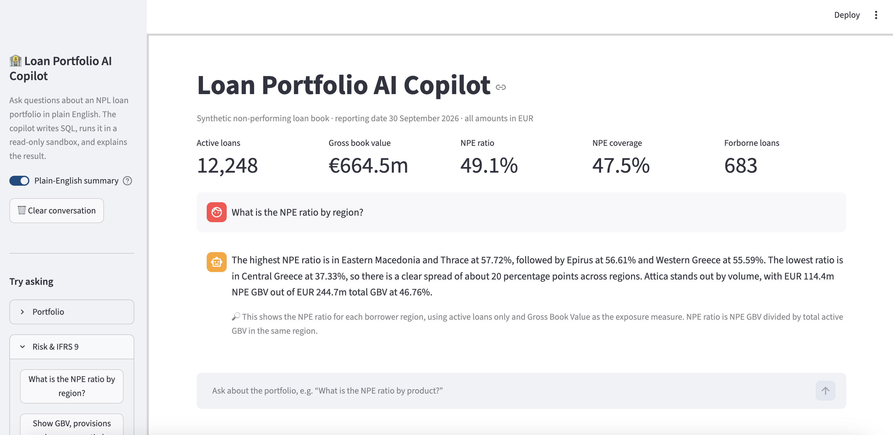
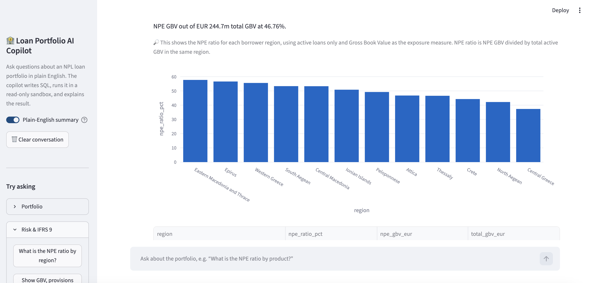
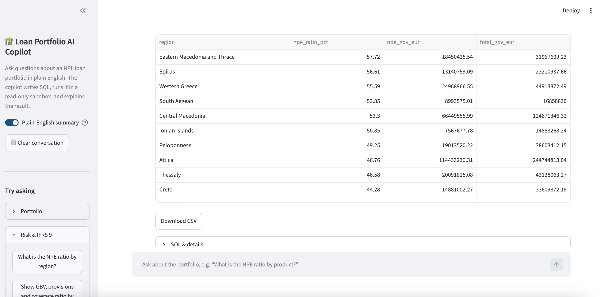
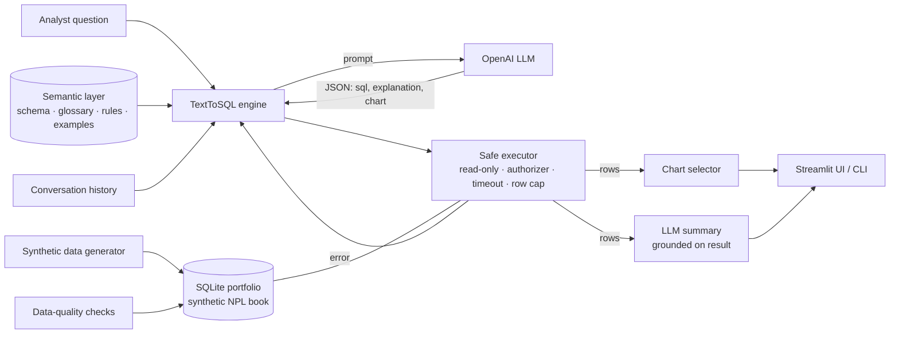
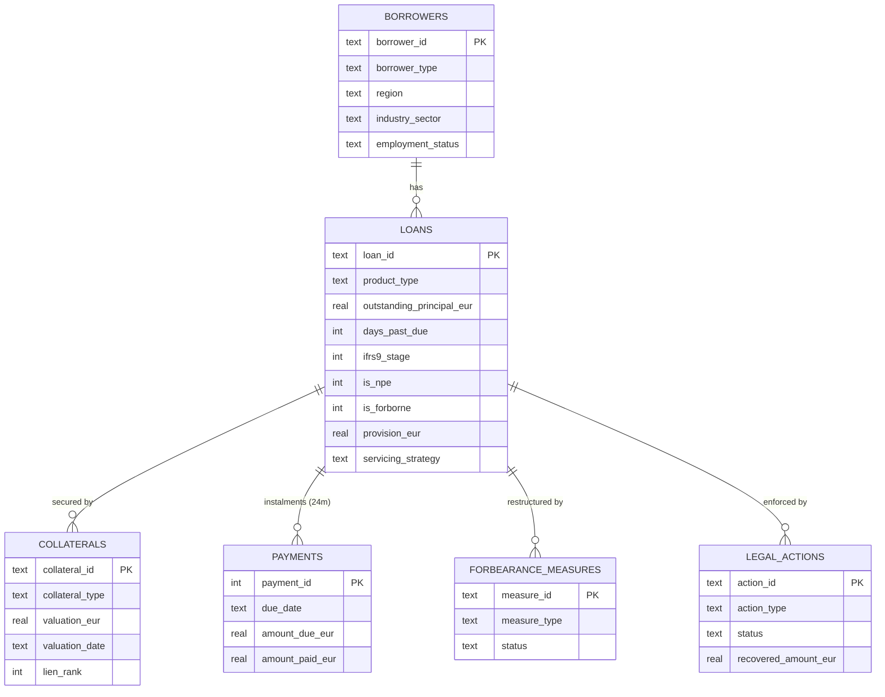

# 🏦 Loan Portfolio AI Copilot

**Ask questions about a non-performing loan (NPL) portfolio in plain English. Get the SQL, the numbers, a chart and a plain-English explanation in seconds.**

The copilot is built for the analysts and portfolio managers of a loan servicer. It understands credit-risk language (NPE ratio, IFRS 9 stages, DPD buckets, forbearance, LTV and coverage) and turns questions into read-only SQL. It runs that SQL in a sandbox that cannot modify or leak data, and it is benchmarked against a gold-standard evaluation set.

> ⚠️ All data is **synthetic**. It is generated by this repository and contains no real customers or institutions.

<p align="center">
  
</p>

<details>
<summary><b>More screenshots: auto-chart and result table</b></summary>
<br>


</details>

---

## Why this project

Most text-to-SQL demos stop at "LLM writes a query". Production teams in regulated finance need more than that:

| Problem in real loan servicing | How the copilot handles it |
|---|---|
| Business terms are not column names ("NPE ratio", "coverage", "restructured twice") | A **semantic layer** (`copilot/semantic_layer.yaml`) defines tables, a credit-risk glossary, SQL conventions and worked examples |
| An LLM must never be able to change data | **Engine-enforced read-only sandbox**. It uses a SQLite authorizer, not regex filtering (see [Safety](#-safety-by-design)) |
| LLM queries sometimes fail | **Self-correction loop**: database errors are fed back to the model, up to N retries |
| "Is it actually correct?" | **Execution-accuracy benchmark**: 28 analyst questions with hand-written gold SQL (`eval/questions.yaml`) |
| Data you can't trust gives answers you can't trust | **Data-quality suite**: 26 checks for referential integrity and EBA / IFRS 9 consistency rules |

## Features

- 💬 **Conversational analytics**: follow-ups keep context ("now split that by region")
- 📊 **Auto-charts**: the LLM suggests a chart, which is validated against the actual result, with a heuristic fallback
- 📝 **Grounded summaries**: a second LLM call explains the result using only numbers from the returned rows
- 🔍 **Full transparency**: every answer shows the SQL, any rejected attempts, latency and token usage
- 📥 **CSV export** of every result
- 🧪 **50 unit tests** that run offline (no API key): sandbox attacks, engine behaviour with a scripted LLM, data rules and the evaluation comparer
- ⌨️ **CLI mode** for terminal use

## Architecture



## Data model

A synthetic book of **20,000 loans / 16,000 borrowers** (as of 30 Sep 2026), loosely modelled on the public EBA NPL data templates. About half the active GBV is non-performing, which is typical of a servicer's portfolio.



The generator enforces the rules a real risk-data team would test for:

- **NPE** ⇔ DPD > 90 **or** unlikely-to-pay. **Stage 3** ⇔ NPE. **Stage 2** for DPD > 30, forborne or SICR.
- **Forborne** ⇔ a measure is active or ended less than 24 months ago (probation period).
- Missed instalments in `payments` line up with DPD. Provisions scale with stage, LTV and time in default.
- It also includes realistic data issues to monitor, such as **stale collateral valuations** older than 3 years.

## Quickstart

Requires **Python 3.10+** and an **OpenAI API key**.

```bash
# 1. install
python3 -m venv .venv && source .venv/bin/activate
pip install -r requirements.txt

# 2. configure
cp .env.example .env          # then put your OPENAI_API_KEY in .env
python scripts/check_openai.py   # verifies key + model

# 3. build the data (≈10 s) and check it
python -m copilot.data.generate
python -m copilot.data.quality

# 4. run
streamlit run app.py
```

Other commands:

```bash
python -m copilot.cli "What is the NPE ratio by region?"   # one-off question
python -m copilot.cli                                     # interactive terminal mode
python -m copilot.eval.run_eval                           # benchmark against the LLM
python -m pytest -q                                       # unit tests (offline)
```


## Example questions

- *What is the NPE ratio by product type?*
- *Show GBV, provisions and coverage ratio by IFRS 9 stage.*
- *How many loans became non-performing in each quarter of 2025?*
- *Which forbearance measure types have the highest re-default rate?*
- *What is the average LTV of non-performing mortgages by region?*
- *How many collaterals have valuations older than 3 years?*
- *How much have we recovered from completed auctions?*

## 🔒 Safety by design

LLM-generated SQL is treated as **untrusted input**. Protection works in layers, and the database engine itself enforces it:

1. The database is opened in **read-only mode** (`mode=ro`).
2. A **SQLite authorizer** runs during query compilation. It allows only `SELECT`, reads of allow-listed tables and views, and safe functions. `INSERT`/`UPDATE`/`DELETE`, DDL, `PRAGMA`, `ATTACH`, `sqlite_master`, `load_extension` and unknown tables are all **denied by the engine**. This includes cases hidden inside CTEs, such as `WITH x AS (...) DELETE ...`.
3. **One statement per call.** Payloads like `SELECT 1; DROP TABLE loans` are rejected.
4. A **wall-clock timeout** stops runaway queries such as infinite recursive CTEs, and a **row cap** limits result size.

All of this is covered by tests in `tests/test_safe_executor.py`.

## 📏 Evaluation

`eval/questions.yaml` contains 28 analyst questions across 11 categories (portfolio, NPE, delinquency, IFRS 9, forbearance, collateral, legal, trends, borrowers, write-offs and strategy). Each one has hand-written gold SQL.

A prediction counts as **correct when its result set matches the gold result set** (execution accuracy). Column names, column order and row order are ignored, and so are rounding and the ratio-vs-percent scale. Extra columns are allowed.

```bash
python -m copilot.eval.run_eval
```

The run writes a markdown report to `eval/results/`, with accuracy per category, failures with their SQL, latency and tokens.

| Model | Execution accuracy | Median latency | Avg tokens / question |
|---|---|---|---|
| `gpt-5.4-mini` (first run) | 96.4% (27/28) | 1.6 s | ~3.2k |
| `gpt-5.4-mini` (after one semantic-layer fix) | **100% (28/28)** | 1.5 s | ~3.2k |

The single first-run failure was a classic credit-risk ambiguity: *"How many loans became non-performing in each quarter?"* was answered with the current NPE **stock** (`is_npe = 1`) instead of NPE **inflows** (all loans whose `default_date` falls in the period, including those later written off). One glossary rule in the semantic layer fixed it, with no code change.

> Note: the benchmark was also used during development, so treat 100% as an upper bound. New, unseen questions are the real test, and adding them to `eval/questions.yaml` is encouraged.

## Project structure

```
├── app.py                       # Streamlit UI
├── copilot/
│   ├── config.py                # settings, paths, allow-listed tables
│   ├── semantic_layer.yaml      # schema docs, credit-risk glossary, SQL rules, examples
│   ├── llm.py                   # LLM client protocol + OpenAI implementation
│   ├── charts.py                # chart validation & heuristics
│   ├── cli.py                   # terminal interface
│   ├── data/
│   │   ├── schema.sql           # DDL with constraints, indexes, overview view
│   │   ├── generate.py          # synthetic NPL portfolio generator
│   │   └── quality.py           # data-quality checks
│   ├── sql/
│   │   ├── engine.py            # question → SQL → execute → self-correct → summarise
│   │   ├── safe_executor.py     # read-only sandbox
│   │   └── semantic.py          # renders the semantic layer for the prompt
│   └── eval/
│       ├── compare.py           # execution-accuracy result comparison
│       └── run_eval.py          # benchmark runner + report
├── eval/questions.yaml          # 28 questions with gold SQL
├── scripts/check_openai.py      # key / model check
└── tests/                       # 50 offline tests
```

## Roadmap

- [x] **Phase 1**: synthetic portfolio, data-quality suite, text-to-SQL with safe execution, self-correction, evaluation, UI
- [ ] **Phase 2**: **RAG over regulation**: answer questions from public EBA/ECB guidance on NPE management and forbearance, with page-level citations
- [ ] **Phase 3**: **Router**: one question can trigger SQL, document search or both ("Which loans were restructured 3+ times, and what do the guidelines say about repeated forbearance?")
- [ ] PostgreSQL + pgvector backend, Docker Compose, CI

## Tech stack

Python · OpenAI API · SQLite · pandas / NumPy · Streamlit · Plotly · pytest

---

Built by **Adam Diamantidis**, Data Engineer (data pipelines, SQL, Azure, Power BI) and MSc Applied Data Science, Utrecht University.
